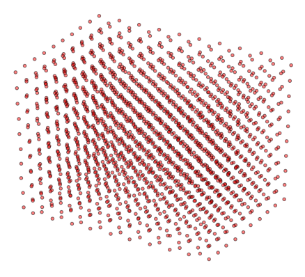
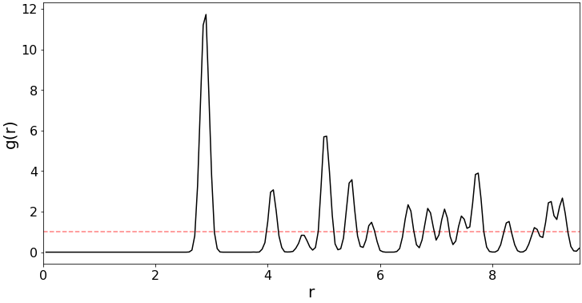
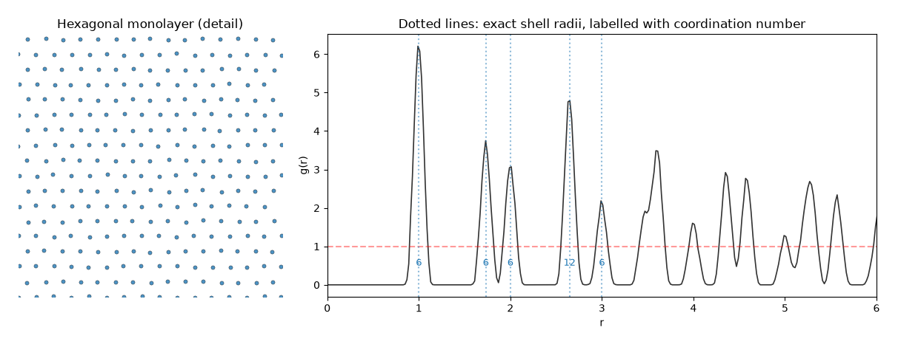

Introduction and Examples
=========================

What are Radial Distribution Functions?
---------------------------------------

The radial distribution function (RDF) (or pair correlation function) characterises the structure of a
system of particles. If we select an arbitrary particle as the origin, the RDF describes the number of
particles we would observe relative to the bulk density of the system, as a function of distance.
This is calculated and averaged over every particle in the structure being considered.

**rdfpy** evaluates :math:`g(r)` on a set of spherical (3D) or annular (2D) shells. Shell :math:`k`
covers the interval :math:`(r_{k}, r_{k}+\delta r]`, and

.. math::
    g(r_{k}) = \frac{1}{N_{\mathrm{valid}}(r_{k})\,\rho\,V_{k}}
               \sum_{i \in \mathrm{valid}(r_{k})} n_{i}(r_{k})

where :math:`n_{i}(r_{k})` is the number of particles at a distance :math:`d` from particle
:math:`i` with :math:`r_{k} < d \leq r_{k}+\delta r`, and :math:`\rho = \frac{N}{V}` is the number
density. Dividing by :math:`\rho` ensures that the RDF is centred around 1 when the density of
particles observed at some distance does not deviate from the bulk density.

The shell volume :math:`V_{k}` is computed exactly rather than with the thin-shell approximation
:math:`4\pi r^{2}\delta r`, so the normalisation stays accurate even when :math:`\delta r` is not
small:

.. math::
    V_{k}^{\mathrm{3D}} = \frac{4}{3}\pi\left[(r_{k}+\delta r)^{3} - r_{k}^{3}\right]
    \qquad
    V_{k}^{\mathrm{2D}} = \pi\left[(r_{k}+\delta r)^{2} - r_{k}^{2}\right]

Edge correction
---------------

**rdfpy** does not assume periodic boundary conditions. Particles near the wall of the box have part
of their neighbour shell outside the box, which would bias :math:`g(r)` downwards. Instead, at each
radius only the particles whose entire shell of radius :math:`r+\delta r` lies inside the box are used
as origins. This is the set :math:`\mathrm{valid}(r_{k})` above, of size
:math:`N_{\mathrm{valid}}(r_{k})`. Every particle remains available as a *neighbour*.

Because that valid set shrinks as :math:`r` grows, the outermost radii are computed from fewer origins
and are noisier. The ``rcutoff`` parameter (default ``0.9``) trims them: the RDF is computed out to
``rcutoff`` times half the shortest box dimension. If a shell ends up with no valid origins at all,
``rdf`` returns ``NaN`` for that bin and emits a ``RuntimeWarning``.

This edge-correction scheme is why results from **rdfpy** differ from tools that apply the periodic
minimum-image convention.

Practical guidance
------------------

Binning convention
~~~~~~~~~~~~~~~~~~

The returned ``radii`` are **bin centres**: element ``k`` describes the shell
:math:`(k\,\delta r, (k+1)\,\delta r]`, so ``radii[0] == dr/2``. A feature in :math:`g(r)` therefore
appears within :math:`\delta r / 2` of its true distance. Plot ``g_r`` directly against ``radii``;
no offset correction is needed.

Choosing ``dr``
~~~~~~~~~~~~~~~

``dr`` trades resolution against noise. Narrow shells resolve close-together peaks but hold fewer
pairs each, so the count in every bin is noisier. For a uniform random system of 8000 particles in a
:math:`20^{3}` box, where the true answer is :math:`g(r) = 1` everywhere, the scatter about that
value grows steadily as ``dr`` shrinks (averaged over 12 random realisations):

===========  ========  ==================
``dr``       bins      std. dev. of g(r)
===========  ========  ==================
0.05         179       0.054
0.1          89        0.036
0.25         35        0.014
0.5          17        0.010
1.0          8         0.007
===========  ========  ==================

Useful starting points:

* Pick ``dr`` well below the shortest feature you need to resolve (for a crystal, perhaps a tenth of
  the nearest-neighbour distance).
* Then check that the flat region at large :math:`r` sits close to 1 without excessive scatter. If it
  is noisy, either increase ``dr`` or use more particles; noise falls roughly as
  :math:`1/\sqrt{N_{\mathrm{pairs}}}` per bin.
* Peaks in a perfectly ordered structure are only ever as narrow as ``dr``, so a sharp-looking peak
  is not evidence of resolution.

Supplying the number density
~~~~~~~~~~~~~~~~~~~~~~~~~~~~

When ``rho`` is not given it is inferred as :math:`N / \prod_i (\max_i - \min_i)` (the bounding box
of the particles themselves). That box stops *at* the outermost particles rather than half a spacing
beyond them, so it underestimates the volume and biases :math:`\rho` high, which biases :math:`g(r)`
low by the same factor.

For uniformly distributed particles the expected bias is :math:`(N/(N-2))^{d}`, closely approximated
by :math:`1 + 2d/N`; it is negligible once :math:`N` is large. For a 3D cube that is 3.1% at
:math:`N = 200`, 0.6% at :math:`N = 1000` and 0.03% at :math:`N = 20\,000`. Any individual
configuration will scatter about these values.

**For a lattice it does not become negligible, and it can be large.** A finite lattice spans only
:math:`(n-1)` spacings across :math:`n` sites, so the bounding box misses a whole spacing per axis:

* A :math:`20 \times 20 \times 20` simple-cubic lattice of spacing 1 has a true density of 1.0, but
  the inferred value is 1.166, i.e. **16.6% high**, which pushes the whole of :math:`g(r)` down by 14%.
* The hexagonal monolayer in ``examples/monolayer_2d.py`` is inferred 1.9% high against its exact
  areal density of :math:`2/(\sqrt{3}a^{2})` (2.3% for the same lattice without the thermal jitter,
  which widens the bounding box slightly).

So pass ``rho`` explicitly whenever you know it (from the crystal structure, from the simulation box
that produced the coordinates, or from the experimental concentration):

.. code-block:: python

   g_r, radii = rdf(coords, dr=0.05, rho=n_particles / box_volume)

A quick check: if the flat part of :math:`g(r)` at large :math:`r` settles on a value other than 1,
the density is wrong by that factor.

Comparing with other tools
~~~~~~~~~~~~~~~~~~~~~~~~~~

**rdfpy** applies the open-boundary edge correction described above. Most molecular-simulation tools
(LAMMPS ``compute rdf``, VMD ``gofr``, MDAnalysis and freud) instead assume **periodic boundary
conditions** and use the minimum-image convention, where every particle is a valid origin because the
box wraps. The two give different answers, and neither is a bug:

* Use a PBC-based tool when your coordinates *came from* a periodic simulation. Applying **rdfpy** to
  a periodic trajectory discards the periodicity and throws away the particles near the box faces.
* Use **rdfpy** when your system genuinely has boundaries (a nanoparticle, a microscopy field of
  view, a particle-tracking dataset, an experimental configuration) where wrapping would invent
  neighbours that do not exist.

Two further differences worth checking before comparing numbers: many tools report bin **centres**
while others report left edges (**rdfpy** reports centres), and normalisation sometimes uses
:math:`N-1` rather than :math:`N` neighbours. Both shift results slightly.

Because the valid-origin set shrinks as :math:`r` grows, **rdfpy** also becomes noisier at large
:math:`r` than a PBC calculation on the same number of particles. That is the cost of not assuming
periodicity, and it is what ``rcutoff`` exists to manage.

Example: RDF of a Crystal Structure
-----------------------------------

In this example, we use **rdfpy** to compute the RDF of crystalline Ti. The Crystallographic Information
File (CIF) can be obtained from `here <https://materialsproject.org/materials/mp-46/#>`_,
and is provided by the  `Materials Project <https://materialsproject.org/>`_. First we import the ``rdf``
function from **rdfpy**, as well as pymatgen for obtaining atom coordinates from the CIF file, and numpy.

We then load the structure and create a supercell so that there are enough atoms in the crystal to compute
an RDF from.

.. code-block:: python

   import numpy as np
   from rdfpy import rdf
   from pymatgen.core import Structure

   structure = Structure.from_file('/path/to/Ti_mp-46_computed.cif')
   structure.make_supercell(10)

   coords = structure.cart_coords

Optionally, add a small amount of noise to model thermal displacement of the atoms about their
lattice sites. This broadens the peaks (it is a physical choice, not something **rdfpy** requires):

.. code-block:: python

   noise = np.random.normal(loc=0.0, scale=0.05, size=coords.shape)
   coords = coords + noise

Finally we use **rdfpy** to compute the RDF from the coordinates, specifying the step size parameter ``dr``:

.. code-block:: python

   g_r, radii = rdf(coords, dr=0.05)

Plotting ``g_r`` against ``radii`` results in the following function.

.. note::

   This figure was produced with rdfpy 1.x and has not been regenerated, because the source CIF is
   not bundled with the project. It predates both the bin-centre convention and the two correctness
   fixes in 2.0, so treat it as illustrative of the *shape* of a crystal RDF rather than as output
   you should expect to reproduce exactly. The figures in ``examples/`` are current.

Example: RDF of a 2D Monolayer
------------------------------

**rdfpy** works on 2D coordinates in exactly the same way; the shells become annuli and the
normalisation uses :math:`\pi[(r+\delta r)^{2} - r^{2}]`. The script
``examples/monolayer_2d.py`` builds a hexagonal (triangular) monolayer with a little thermal
disorder, so you can change the lattice or the disorder and see the effect immediately rather than
loading a fixed data file.

.. code-block:: python

   import numpy as np
   from rdfpy import rdf

   a = 1.0
   i, j = np.meshgrid(np.arange(60), np.arange(70), indexing='ij')
   x = (i + 0.5 * (j % 2)) * a          # alternate rows offset by a/2
   y = j * (np.sqrt(3) / 2) * a
   particles = np.stack([x.ravel(), y.ravel()], axis=1)
   particles += np.random.default_rng(0).uniform(-0.06, 0.06, particles.shape)

   # the areal density of a triangular lattice is known exactly
   g_r, radii = rdf(particles, dr=0.02, rho=2 / (np.sqrt(3) * a**2))

The dotted lines mark the exact neighbour distances of a triangular lattice (:math:`a`,
:math:`\sqrt{3}a`, :math:`2a`, :math:`\sqrt{7}a`, :math:`3a`) labelled with their coordination
numbers 6, 6, 6, 12 and 6. Integrating :math:`\rho\,g(r)\,A_{\mathrm{shell}}` over each peak recovers
those integers, which is a good way to check an RDF against a structure you know:

.. code-block:: text

   shell      integrated    exact
   r = 1.000       5.996        6
   r = 1.732       6.014        6
   r = 2.000       6.055        6
   r = 2.646      11.999       12
   r = 3.000       5.997        6
